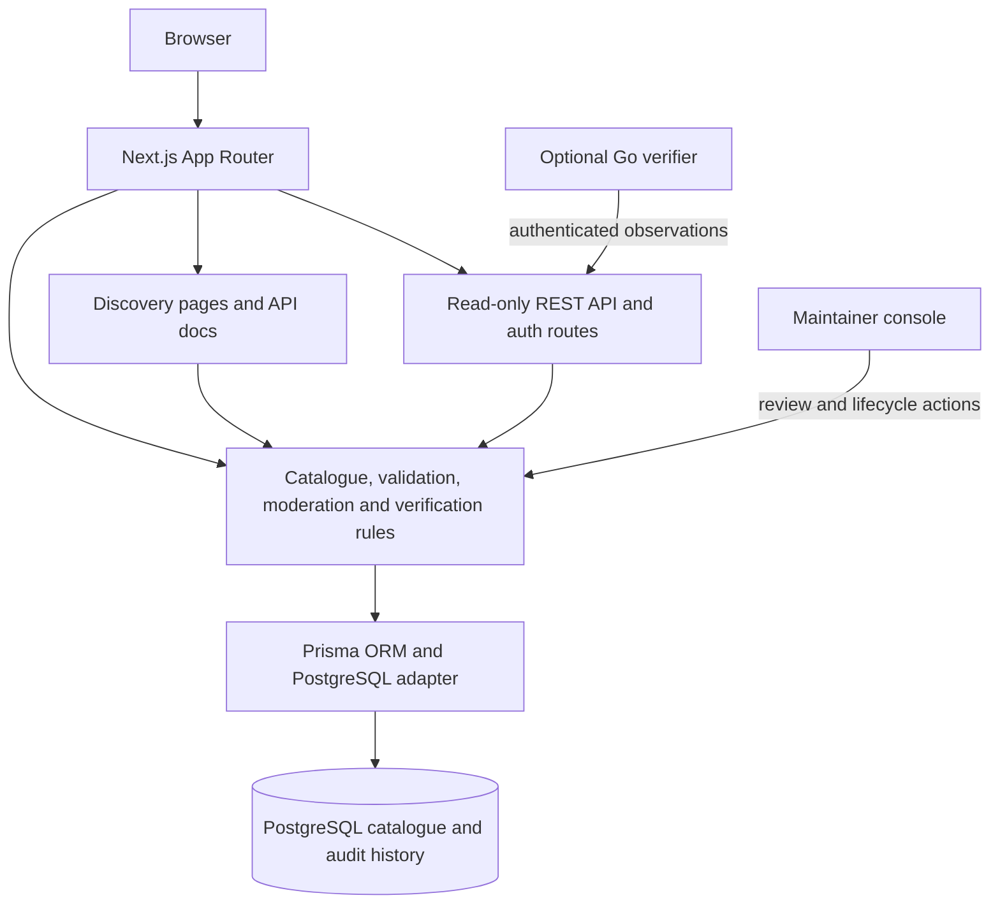

# APIVault

**The GitHub of APIs — discovery, verification and community.**

APIVault is an open-source API discovery and intelligence platform. Explore a curated catalogue, inspect API capabilities and requirements, review verification evidence, and help improve the directory through community submissions.

The idea is simple: APIs should be as discoverable, reviewable and community-maintained as open-source code.

## What you can do

### Discover APIs
- Browse, search, filter and sort a structured API catalogue.
- Open API detail pages with provider information, documentation links and available metadata.
- Use the read-only, versioned REST API to access published catalogue records.

### Verify with evidence
- Keep verification evidence and publication status tied to canonical API records.
- Use the Go-based verifier for API homepage checks.
- Review verification history and stale observations in the admin tooling.

Verification is evidence-based; a listing is not a guarantee of provider uptime, service quality, security, or continued availability.

### Build with APIVault
- Explore the interactive API reference and playground at /docs.
- Read the canonical OpenAPI document at /openapi.json.
- Create optional read-only API keys from /account when an account has been provisioned.

### Contribute to the catalogue
- Suggest APIs, corrections and better source metadata.
- Submissions enter a moderation workflow and are not published automatically.
- Opt-in contributor profiles and submission history help recognize community work.

## Project status

APIVault is under active development toward its first official v1.0.0 general-availability launch. Incremental 0.x releases will document tested development milestones and be published as GitHub prereleases. Public registration is currently disabled; contributor accounts are provisioned by maintainers. Some catalogue data imports are review-only and require maintainer verification before publication.

See the [delivery roadmap](docs/ROADMAP.md), [v1.0.0 launch plan](docs/LAUNCH_PLAN.md), [release strategy](docs/RELEASE_STRATEGY.md), and [release-readiness checklist](docs/RELEASE_READINESS.md).

## Product architecture

The browser never connects directly to PostgreSQL. Public endpoints serialize only published records; the optional verifier reports observations but cannot publish or verify records by itself. See the full [architecture guide](docs/ARCHITECTURE.md).

## Technology

- Next.js 16, React 19, TypeScript, and Tailwind CSS 4.
- PostgreSQL 18 with Prisma ORM 7.
- Zod for runtime validation.
- Go verifier service.
- GitHub Actions for repository, application, browser and container checks.

## Run locally

For a guided first-time setup, install Node.js 24 and Docker Compose, clone the repository, then run `npm run setup:local`. The script creates a local `.env` if needed, generates a local auth secret, installs dependencies, starts PostgreSQL, applies migrations, and seeds categories. It does not create an administrator or sample API listings. For manual setup and troubleshooting, use the step-by-step [setup guide](docs/SETUP.md) and [local development reference](docs/LOCAL_DEVELOPMENT.md). Read the [architecture](docs/ARCHITECTURE.md), [canonical data model](docs/DATA_MODEL.md), [verification policy](docs/VERIFICATION_POLICY.md), and [catalogue curation guide](docs/CATALOGUE_CURATION.md) before changing catalogue behaviour.

## Public API

The public API is read-only and exposes published catalogue listings, individual API records, and categories. The [OpenAPI specification](docs/openapi.json) documents the available endpoints. Read the [API usage policy](docs/API_USAGE_POLICY.md) for rate limits, caching, attribution and fair-use expectations.

## Contributing

Contributions of code, API listings, data corrections, tests and documentation are welcome. Start with the [first-contribution quickstart](docs/CONTRIBUTOR_QUICKSTART.md), then read [CONTRIBUTING.md](CONTRIBUTING.md) before opening a pull request. API suggestions should include official source links and can be submitted using the [Suggest an API issue form](https://github.com/yyyuvvvraj/APIVault/issues/new?template=api_submission.yml).

## Community

- [GitHub Discussions](https://github.com/yyyuvvvraj/APIVault/discussions)
- [Report a bug](https://github.com/yyyuvvvraj/APIVault/issues/new?template=bug_report.yml)
- [Request a feature](https://github.com/yyyuvvvraj/APIVault/issues/new?template=feature_request.yml)
- [Security policy](SECURITY.md)
- [Code of Conduct](CODE_OF_CONDUCT.md)

## Development workflow

- dev is the default integration branch.
- Work on short-lived branches such as feature/add-api-catalogue or docs/improve-readme.
- Open pull requests into dev; do not push directly to protected branches.
- Stable releases are prepared from dev and published from stable with version tags. See the [release strategy](docs/RELEASE_STRATEGY.md).

## License

APIVault is licensed under the [MIT License](LICENSE).
